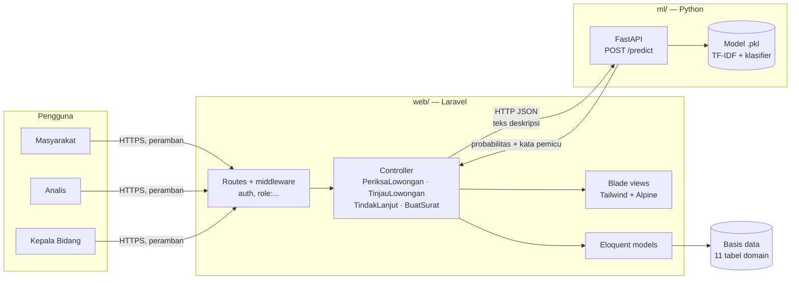
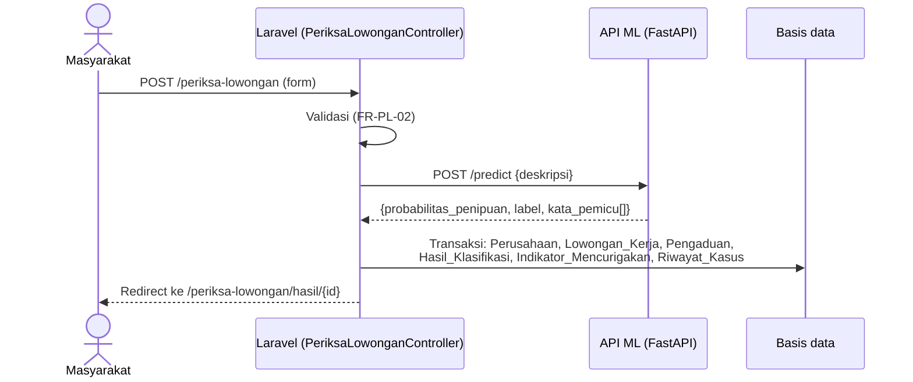
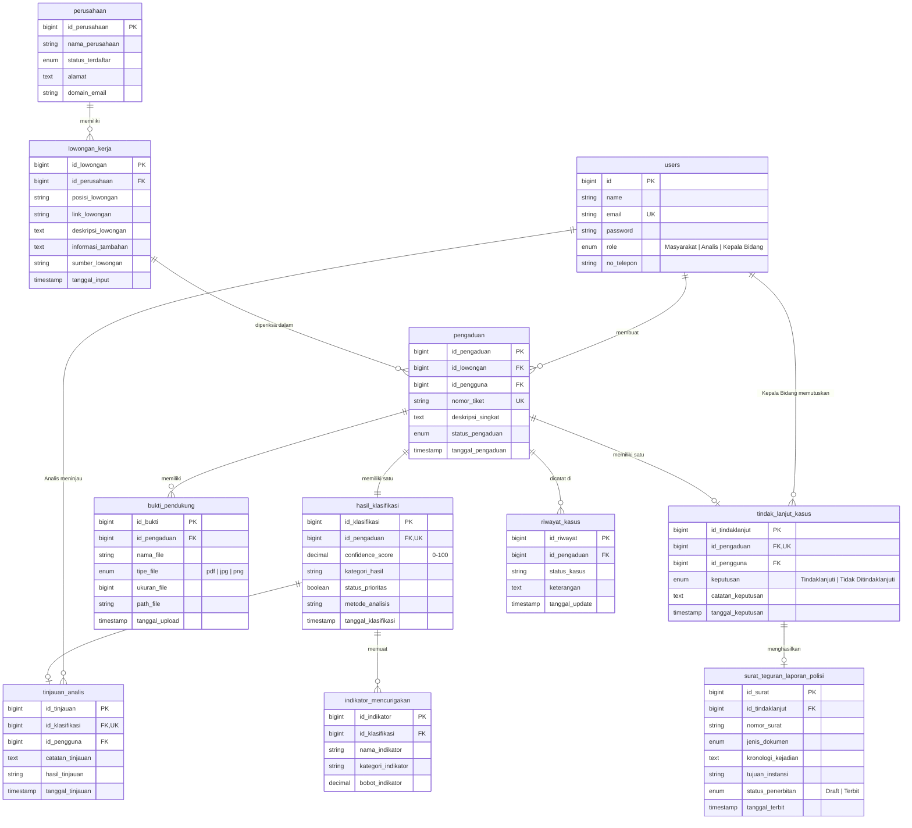

# Arsitektur — LokerLens

Dokumen terkait: [prd.md](prd.md) · [requirements.md](requirements.md) · [design.md](design.md)

---

## 1. Gambaran Umum

LokerLens terdiri dari tiga bagian (SRS 2.1, 3.2):

| Bagian | Folder | Teknologi | Tugas |
|---|---|---|---|
| Aplikasi web | `web/` | Laravel 13, PHP 8.3+, Blade + Tailwind CSS + Alpine.js, Laravel Breeze (autentikasi) | Semua halaman, alur kasus, hak akses per peran, penyimpanan data |
| Layanan ML | `ml/` | Python, scikit-learn (TF-IDF + model terbaik), FastAPI + Uvicorn | Menerima teks deskripsi lowongan, mengembalikan probabilitas penipuan dan kata pemicu |
| Basis data | `web/database/` | Relasional. Saat pengembangan memakai SQLite. **[PERLU DISKUSI]** DBMS produksi (SRS 2.4: TBD) | Menyimpan 11 tabel domain sesuai PDM |

LokerLens **tidak terhubung dengan sistem eksternal** (SRS 2.1). Layanan ML adalah bagian internal LokerLens, bukan sistem luar.



### Alur satu pemeriksaan



> **Catatan:** saat ini langkah "POST /predict" masih diganti dengan simulasi kata kunci di `PeriksaLowonganController::simulasiKlasifikasi()`. Folder `ml/` baru berisi `requirements.txt` dan folder kosong (`data/`, `notebooks/`, `src/`, `models/`).

---

## 2. Struktur Folder

```
LokerLens/
├── web/                     ← aplikasi Laravel (jalankan semua perintah artisan/npm dari sini)
│   ├── app/
│   │   ├── Constants/LokerLensCopy.php   ← teks resmi UI & status
│   │   ├── Http/Controllers/             ← satu controller per fitur
│   │   ├── Http/Middleware/CheckRole.php ← pembatasan per peran
│   │   └── Models/                       ← 10 model domain + User
│   ├── database/migrations/              ← skema tabel
│   ├── resources/views/                  ← halaman per fitur
│   └── routes/web.php                    ← daftar route per peran
├── ml/                      ← komponen machine learning
│   ├── data/      (data mentah di data/raw/ diabaikan git)
│   ├── notebooks/ (eksplorasi & perbandingan model)
│   ├── src/       (kode training & API)
│   └── models/    (file *.pkl diabaikan git)
└── docs/                    ← dokumen proyek (docs/referensi/ diabaikan git)
```

---

## 3. Basis Data

### 3.1 Tabel dan relasi (dari migration)



Semua tabel domain juga punya kolom `created_at` dan `updated_at` (bawaan Laravel). Selain 11 tabel domain, ada tabel bawaan Laravel: `password_reset_tokens`, `sessions`, `cache`, `cache_locks`, `jobs`, `job_batches`, `failed_jobs`.

### 3.2 Perbandingan dengan PDM di SRS (Table 6.1, Figure 6.2)

| Tabel | PDM SRS | Migration | Perbedaan |
|---|---|---|---|
| Pengguna | `Pengguna`: `id_pengguna`, `nama`, `email` (AK), `password`, `role`, `no_telepon`, `tanggal_daftar` | `users`: `id`, `name`, `email` (unique), `password`, `role`, `no_telepon`, `created_at`, `email_verified_at`, `remember_token` | Nama tabel dan kolom mengikuti bawaan Laravel/Breeze: `id_pengguna`→`id`, `nama`→`name`, `tanggal_daftar`→`created_at`. Ada kolom tambahan untuk verifikasi email dan "ingat saya". FK di tabel lain tetap bernama `id_pengguna`. |
| Perusahaan | sesuai | sesuai | Tidak ada. `status_terdaftar` berupa enum `Terdaftar / Tidak Terdaftar / Belum Diverifikasi` (nilai tidak dirinci di PDM). |
| Lowongan_Kerja | sesuai | sesuai | Tidak ada. |
| Pengaduan | `nomor_tiket` (AK), `status_pengaduan` | `nomor_tiket` unique, `status_pengaduan` enum 7 nilai lama | Nilai status di migration belum sesuai alur status keputusan tim (lihat [requirements.md §5](requirements.md#5-alur-status-kasus-keputusan-tim)). |
| Bukti_Pendukung | `tipe_file` | `tipe_file` enum `pdf / jpg / png` | Tidak ada. Ekstensi `.jpeg` harus diseragamkan menjadi `jpg` sebelum disimpan. |
| Hasil_Klasifikasi | `id_pengaduan` (AK) | unique | Tidak ada. |
| Indikator_Mencurigakan | sesuai | sesuai | Tidak ada. |
| Tinjauan_Analis | `id_klasifikasi` (AK) | unique | Tidak ada. `hasil_tinjauan` berupa string bebas (100 karakter). |
| Tindak_Lanjut_Kasus | `id_pengaduan` (AK) | unique | Tidak ada. |
| Surat_Teguran_Laporan_Polisi | `id_tindaklanjut` (**AK**), `nomor_surat` (**AK**) | `id_tindaklanjut` dan `nomor_surat` **tidak unique** | **Berbeda.** Di PDM keduanya kunci alternatif (satu surat per tindak lanjut, nomor surat unik), tapi migration tidak memasang constraint unique. Untuk sementara keunikan dijaga di kode (`updateOrCreate` per `id_tindaklanjut`). |
| Riwayat_Kasus | sesuai | sesuai | Tidak ada. `status_kasus` berupa string bebas. |

---

## 4. Hak Akses per Peran

Dua lapis pembatasan dipasang di `web/routes/web.php`:
1. `auth`: semua route fitur wajib login (NFR-SEC-01).
2. `role:<Peran>`: middleware `CheckRole` menolak dengan 403 kalau peran pengguna tidak cocok (NFR-SEC-02).

| Grup route | Peran |
|---|---|
| `/beranda`, `/periksa-lowongan/*` | Masyarakat |
| `/tinjau-lowongan/*` | Analis |
| `/tindak-lanjut/*`, `/buat-surat/*` | Kepala Bidang |
| `/profile` | Semua peran yang login |

Setelah login, pengguna diarahkan sesuai peran (`AuthenticatedSessionController::redirectByRole`): Masyarakat ke Beranda, Analis ke Tinjau Lowongan, Kepala Bidang ke Tindak Lanjut.

---

## 5. Rencana Integrasi Laravel ↔ API ML

### 5.1 Endpoint

| Method | Path | Fungsi |
|---|---|---|
| `GET` | `/health` | Cek layanan hidup dan versi model yang dimuat. |
| `POST` | `/predict` | Mengklasifikasikan satu teks deskripsi lowongan. |

Alamat API disimpan di konfigurasi Laravel, misalnya `ML_API_URL=http://127.0.0.1:8001` di `web/.env`, dibaca lewat `config/services.php`. Laravel memanggilnya dengan `Http::timeout(...)->post(...)`. Batas waktu harus memberi ruang untuk target NFR-PERF-02 (≤ 5 detik total).

### 5.2 Format input

Sesuai keputusan tim, **input model hanya teks deskripsi lowongan** (bahasa Indonesia):

```json
POST /predict
{
  "deskripsi": "PT Mandiri Sukses Global membuka lowongan Staff Administrasi. Gaji Rp8.000.000–Rp12.000.000 per bulan, tanpa pengalaman. Kandidat diminta membayar biaya administrasi Rp150.000 sebelum wawancara."
}
```

Nama perusahaan, posisi, link, informasi tambahan, dan checklist **tidak dikirim** ke model. Data itu tetap disimpan di database untuk ditinjau Analis.

> **[PERLU DISKUSI]** Data Mockup 2.3 menyebut sistem memproses deskripsi **dan** informasi tambahan, sedangkan keputusan tim hanya deskripsi. Apakah checklist dan informasi tambahan tetap memengaruhi skor (di luar model), atau hanya disimpan?

### 5.3 Format output

Output dua kelas (asli/palsu) dalam bentuk probabilitas penipuan:

```json
{
  "probabilitas_penipuan": 0.92,
  "label": "palsu",
  "kata_pemicu": [
    { "kata": "biaya administrasi", "bobot": 0.31 },
    { "kata": "tanpa pengalaman",   "bobot": 0.18 },
    { "kata": "sebelum wawancara",  "bobot": 0.12 }
  ],
  "versi_model": "logreg-tfidf-2026-10"
}
```

| Field | Arti | Disimpan ke |
|---|---|---|
| `probabilitas_penipuan` | 0–1, peluang kelas "palsu". Laravel mengalikannya dengan 100. | `hasil_klasifikasi.confidence_score` (0–100) |
| `label` | `"asli"` atau `"palsu"` | dasar `hasil_klasifikasi.kategori_hasil` |
| `kata_pemicu[]` | kata/frasa yang paling mendorong ke arah "palsu", urut dari bobot terbesar | satu baris `indikator_mencurigakan` per kata (`nama_indikator` = kata, `bobot_indikator` = bobot × 100) |
| `versi_model` | identitas model untuk jejak audit | `hasil_klasifikasi.metode_analisis` |

Laravel lalu menentukan:
- `status_prioritas = confidence_score >= config('lokerlens.ambang_prioritas')`, dengan default 70 (dibuat di Tahap 3).
- Status awal kasus: *Perlu Tinjauan* (prioritas tinggi) atau *Selesai - Risiko Rendah* (di bawah ambang).

> **[PERLU DISKUSI]** Ambang label asli/palsu (SRS 6.2) belum ditetapkan. Apakah 50%, atau sama dengan ambang prioritas?
> **[PERLU DISKUSI]** Isi `kategori_indikator` untuk kata pemicu dari model. Model tidak mengelompokkan kata ke kategori seperti "Biaya Fiktif". Usulan: isi dengan "Kata Pemicu Model".
> **[PERLU DISKUSI]** Jika API ML mati atau timeout, apa yang dilakukan sistem? Usulan sesuai NFR-SAF-04: tolak pemeriksaan, tampilkan pesan error, isian tetap ada, dan tidak ada data yang tersimpan sebagian. Teks pesannya belum ada di daftar teks resmi.

### 5.4 Cara mengambil kata pemicu dari model

Kata pemicu adalah kata/frasa **yang ada di teks tersebut** dan paling besar sumbangannya ke arah kelas "palsu" (NFR-QUA-06). Caranya bergantung pada model yang menang:

| Model | Cara menghitung sumbangan kata *w* di dokumen *d* |
|---|---|
| **Logistic Regression** | `tfidf(w, d) × koefisien(w)`. Ambil *k* terbesar yang bernilai positif (mendorong ke "palsu"). |
| **SVM linear** | Sama: `tfidf(w, d) × bobot(w)` dari `coef_`. Probabilitas didapat dengan membungkus model memakai `CalibratedClassifierCV`, karena SVM tidak langsung menghasilkan probabilitas. |
| **Naive Bayes (Multinomial)** | `tfidf(w, d) × [log P(w | palsu) − log P(w | asli)]` dari `feature_log_prob_`. |
| **Random Forest** | `feature_importances_` hanya bersifat global (sama untuk semua dokumen), jadi tidak cocok. Pakai penjelasan per dokumen, misalnya SHAP `TreeExplainer`, atau cara sederhana *leave-one-out*: hapus satu kata, lihat seberapa turun probabilitasnya. |

Catatan praktis:
- Pakai `TfidfVectorizer(ngram_range=(1, 2))` supaya frasa dua kata seperti "biaya administrasi" bisa muncul sebagai pemicu, sesuai contoh di Data Mockup.
- Kata pemicu ditampilkan dalam bentuk aslinya, bukan bentuk hasil *stemming*, agar Masyarakat bisa mencarinya sendiri di teks. Simpan peta "token → kata asli" saat *preprocessing*.
- BDD SRS Table B.2 mengharuskan kata **"biaya"** muncul di elemen `kata-pemicu` untuk contoh "wajib transfer biaya pendaftaran". Jadikan ini salah satu uji model.
- **[PERLU DISKUSI]** Nilai *k* (jumlah minimal kata pemicu, NFR-QUA-06).

### 5.5 Risiko: model belajar sumber data, bukan ciri penipuan

**Masalahnya:** data palsu berasal dari Kaggle, sedangkan data asli dari hasil *scraping*. Dua sumber ini punya "gaya" yang berbeda, misalnya nama situs, URL, kalimat template portal ("Lamar sekarang di …", "Diposting 3 hari lalu"), format gaji, atau bagian footer. Model bisa mendapat akurasi tinggi hanya karena mengenali **asal sumber**, bukan ciri penipuan. Saat dipakai untuk lowongan baru dari sumber lain, hasilnya bisa salah total. Kata pemicu juga akan berisi hal tak bermakna, seperti nama portal.

**Cara mengatasi:**
1. **Bersihkan teks khas sumber sebelum training**, pada kedua kelas:
   - Hapus URL, alamat email, nomor telepon, dan *mention* (atau ganti dengan token umum seperti `<URL>`, `<EMAIL>`, `<TELEPON>`). Jangan menghapus ciri yang memang tanda penipuan, misalnya domain email gratisan. Ganti menjadi token seperti `<EMAIL_GRATIS>` vs `<EMAIL_PERUSAHAAN>`.
   - Hapus nama situs/portal dan merek (misalnya nama portal lowongan, "Kaggle").
   - Hapus kalimat template portal: header, footer, tombol, tanggal posting, jumlah pelamar.
   - Seragamkan format: huruf kecil, spasi, tanda baca, format angka/gaji.
2. **Periksa kata berbobot terbesar** setelah training. Kalau 20 kata teratas berisi nama situs atau potongan template, berarti pembersihan belum cukup.
3. **Uji dengan lowongan baru dari sumber campuran**, yaitu data yang tidak ikut training dan berasal dari sumber yang tidak dipakai saat training. Bandingkan metriknya dengan data uji biasa. Kalau turun jauh, model masih bergantung pada sumber.
4. Kalau memungkinkan, ambil juga sebagian data asli dan palsu dari **sumber yang sama**, supaya model terpaksa belajar dari isi teks.

### 5.6 Rencana struktur `ml/`

```
ml/
├── data/raw/          ← data mentah Kaggle & hasil scraping (diabaikan git)
├── data/processed/    ← data setelah dibersihkan
├── notebooks/         ← eksplorasi, perbandingan NB / LR / SVM / RF
├── src/
│   ├── preprocess.py  ← pembersihan teks (termasuk §5.5)
│   ├── train.py       ← training + evaluasi (accuracy, precision, recall, F1)
│   ├── explain.py     ← ekstraksi kata pemicu (§5.4)
│   └── api.py         ← FastAPI: /health, /predict
└── models/            ← model terbaik *.pkl (diabaikan git)
```

Karena file `*.pkl` tidak masuk git, **[PERLU DISKUSI]** bagaimana model dibagikan ke anggota tim: dilatih ulang tiap anggota, atau disimpan di tempat bersama (misalnya Google Drive)?
