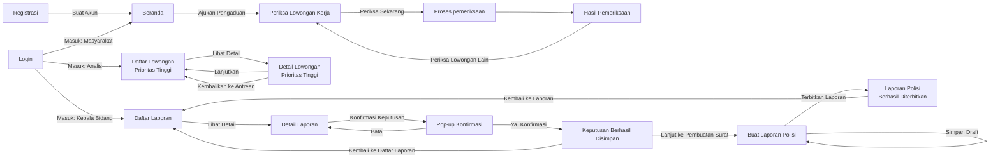

# Desain Antarmuka — LokerLens

**Acuan utama:** Data Mockup LokerLens (`docs/referensi/`, tidak masuk git). Nomor gambar di dokumen ini merujuk ke Data Mockup.
Dokumen terkait: [prd.md](prd.md) · [requirements.md](requirements.md) · [architecture.md](architecture.md)

Semua data di mockup (nama, akun, perusahaan, nomor tiket) adalah **data fiktif**.

---

## 1. Daftar Halaman per Aktor

| Aktor | Halaman | Gambar mockup | Route di kode |
|---|---|---|---|
| Semua | Registrasi | 2.1 | `GET /register` |
| Semua | Login | 2.2 | `GET /login` |
| Semua | Login gagal | 2.3 | `POST /login` (gagal) |
| Masyarakat | Beranda | 2.4 | `GET /beranda` |
| Masyarakat | Periksa Lowongan Kerja: input | 2.5 | `GET /periksa-lowongan` |
| Masyarakat | Periksa Lowongan Kerja: proses pemeriksaan | 2.6 | (di halaman yang sama, Alpine.js) |
| Masyarakat | Hasil Pemeriksaan | 2.7 | `GET /periksa-lowongan/hasil/{id}` |
| Analis | Daftar Lowongan Prioritas Tinggi | 2.8 | `GET /tinjau-lowongan` |
| Analis | Detail Lowongan Prioritas Tinggi | 2.9 | `GET /tinjau-lowongan/detail/{id}` |
| Kepala Bidang | Daftar Laporan | 2.10, 2.14 | `GET /tindak-lanjut` |
| Kepala Bidang | Detail Laporan | 2.11 | `GET /tindak-lanjut/{id}` |
| Kepala Bidang | Pop-up Konfirmasi Keputusan | 2.12 | Modal di halaman detail |
| Kepala Bidang | Hasil Keputusan | 2.13 | `GET /tindak-lanjut/{id}/hasil` |
| Kepala Bidang | Form Buat Surat Teguran/Laporan Polisi | 2.15 | `GET /buat-surat/{pengaduanId}` |
| Kepala Bidang | Hasil Akhir Laporan Polisi | 2.16 | `GET /buat-surat/{pengaduanId}/terbit/{suratId}` |

Halaman yang muncul di menu mockup tapi **belum ada desainnya**: Status Pengaduan, Riwayat Pengaduan, Dashboard (semua peran), Arsip Kasus. **[PERLU DISKUSI]** Masuk cakupan atau tidak (SRS Appendix C no. 7)?

---

## 2. Alur Antar Halaman

---

## 3. Elemen Penting per Halaman

### 3.1 Registrasi dan Login (Gambar 2.1–2.3)
- Tata letak dua kolom. Kiri: panel navy berisi logo, judul *serif* besar ("Mulai langkah aman Anda *bersama LokerLens.*" / "Aman untuk melapor. *Jelas untuk dipantau.*"), foto, dan kartu "Akses terlindungi". Kanan: form di latar krem.
- Registrasi: Nama Lengkap, Email, Kata Sandi, Konfirmasi Kata Sandi (ikon mata), checkbox persetujuan Kebijakan Privasi dan Syarat Layanan, tombol **Buat Akun**.
- Login: Email, Kata Sandi, **Ingat saya**, **Lupa kata sandi?**, tombol **Masuk**.
- Login gagal: kotak merah muda dengan judul **Gagal masuk**, dan kolom email serta kata sandi ditandai merah.

### 3.2 Beranda Masyarakat (Gambar 2.4)
- Navbar: **Ajukan Pengaduan · Status Pengaduan · Riwayat Pengaduan** dan nama akun.
- Hero: "Waspadai lowongan mencurigakan, *lindungi langkah kariermu.*", dengan tombol **Ajukan Pengaduan** dan **Cek Status Pengaduan**.
- Layanan Utama: tiga kartu bernomor (01 Ajukan Pengaduan, 02 Status Pengaduan, 03 Riwayat Pengaduan).
- Pengaduan Terbaru Anda: daftar atau pesan kosong **"Belum ada pengaduan yang diajukan"**.
- Cara Kerja: empat tahap (Ajukan Pengaduan → Pemeriksaan Laporan → Pemantauan Status → Hasil Penanganan).
- Footer: Layanan, Bantuan (Panduan Pengaduan, Cara Kerja, Pusat Bantuan).

### 3.3 Periksa Lowongan Kerja (Gambar 2.5–2.7)
- **Input:** kartu "Formulir Analisis Lowongan" dengan isian Link Lowongan Kerja (Opsional), Nama Perusahaan \*, Posisi Lowongan \*, Deskripsi Lowongan \* (minimal 50 karakter), dan Informasi Tambahan & Kontak. Ada juga panel gelap "Checklist Cepat Indikasi Bahaya" berisi 4 pilihan. Tombol: **Reset Form** dan **Periksa Sekarang**.
- **Proses:** panel progres "Sedang menganalisis lowongan..." dengan persentase dan tiga tahap (Informasi diterima → Memeriksa indikasi bahaya → Menyusun hasil). Isian dikunci, dan tombol berubah menjadi **Sedang Memeriksa...**.
- **Hasil:** kartu biru muda berisi label "Analisis selesai", "Risiko tinggi", kategori ("Lowongan berpotensi penipuan"), dan kotak angka besar **92% Probabilitas penipuan** dengan bar merah. Di bawahnya ada pita peringatan gelap, lalu kartu Informasi lowongan, Ringkasan analisis sistem, Indikasi bahaya yang terdeteksi (tiap kartu memuat kutipan kata pemicu berwarna merah), Bukti pendukung & lampiran, dan Rekomendasi tindak lanjut. Tombol: **Lihat Riwayat** dan **Periksa Lowongan Lain**.

### 3.4 Meninjau Lowongan Kerja dengan Prioritas Tinggi (Gambar 2.8–2.9)
- Navbar Analis: **Dashboard · Laporan · Pemantauan (aktif) · Arsip Kasus**.
- **Daftar:** judul "Daftar Lowongan Prioritas Tinggi", lencana "14 Menunggu Verifikasi Manual", kotak pencarian "Cari ID / Perusahaan / Kata kunci", filter skor, dan urutan ("Urutkan: Risiko Tertinggi"). Kolom tabel: ID LOWONGAN, NAMA PERUSAHAAN, POSISI DITAWARKAN, CONFIDENCE SCORE ("92% Indikasi Penipuan"), STATUS SISTEM (PERLU TINJAUAN SEGERA / MENUNGGU VERIFIKASI / INVESTIGASI AWAL), AKSI (**Lihat Detail**). Di bawah ada paginasi.
- **Detail:** pita kasus aktif, kartu hasil klasifikasi (92% + label KRITIS), Informasi lowongan, Ringkasan analisis sistem, Indikasi bahaya, Bukti pendukung & lampiran dokumen. Di bawah ada "Formulir Keputusan & Rekomendasi Tindak Lanjut" berisi "Catatan Ringkasan Hasil Audit Investigasi \*" dan checkbox notifikasi darurat. Tombol: **Kembalikan ke Antrean**, **Tandai Terkonfirmasi Penipuan (Blacklist)**, dan **Lanjutkan | Menindaklanjuti Laporan**.

### 3.5 Menindaklanjuti Laporan (Gambar 2.10–2.14)
- Navbar Kepala Bidang: **Dashboard · Laporan (lencana jumlah) · Pemantauan · Arsip Kasus**.
- **Daftar Laporan:** hero navy "Pusat Penanganan Laporan – Daftar Laporan" dengan kotak "03 Menunggu keputusan · 2 Prioritas tinggi · 1 Prioritas sedang". Ada baris pencarian dan filter Status/Prioritas. Bagian "01 Antrean Keputusan" berisi kartu laporan (ID, tanggal masuk, posisi, perusahaan, lokasi, temuan, label prioritas, status, *confidence score*, tombol **Lihat Detail**).
- **Detail Laporan:** panel bernomor 01–06: Informasi Kasus, Informasi Lowongan Kerja (frasa mencurigakan digarisbawahi), Pemeriksaan Sistem (skor, kategori "Terindikasi Penipuan", kata pemicu), Tinjauan Analis, Bukti Pendukung (tombol **Lihat Bukti**), dan Keputusan Kepala Bidang (pilihan A **Tindaklanjuti** / B **Tidak Ditindaklanjuti**, Catatan Keputusan, tombol **Kembali ke Daftar** dan **Konfirmasi Keputusan**). Paling bawah ada jejak audit Riwayat Kasus.
- **Pop-up Konfirmasi:** "Periksa kembali keputusan – Konfirmasi Keputusan" berisi ringkasan ID, posisi, keputusan, dan catatan, serta teks "Kasus akan dilanjutkan ke tahap penanganan berikutnya. Keputusan tidak dapat diubah setelah dikonfirmasi." Tombol: **Batal** dan **Ya, Konfirmasi**.
- **Hasil Keputusan:** "Keputusan Berhasil Disimpan", "Kasus berhasil ditandai untuk ditindaklanjuti.", ringkasan (status terbaru "Tindak Lanjut Disetujui", "Perubahan status berhasil dicatat"). Tombol: **Kembali ke Daftar Laporan** dan **Lanjut ke Pembuatan Surat**.

### 3.6 Buat Surat Teguran/Laporan Polisi (Gambar 2.15–2.16)
- **Form "Buat Laporan Polisi":** enam panel bernomor dengan gaya `[ 1. Data Kasus ]`: Data Kasus (read-only), Nama Perusahaan (Terlapor), Kronologi Kejadian (dapat diedit), Detail Pelanggaran (checkbox pasal), Bukti Pendukung (+ tambah file PDF/JPG/PNG maks 10 MB), dan Tujuan Kepolisian (dropdown). Ada blok penanda tangan. Tombol: **Simpan Draft** dan **Terbitkan Laporan**.
- **Hasil:** ikon centang hijau, "Laporan Polisi Berhasil Diterbitkan", lencana **Kasus terdokumentasi otomatis** dan **Kasus selesai**, Ringkasan Dokumen Laporan (nomor dokumen `#LP-2026/POLRI/8821`, tiket, tanggal terbit, terlapor, tujuan, pejabat), dan daftar berkas bukti. Tombol: **Cetak Tanda Terima**, **Kembali ke Laporan**, dan **Lihat Arsip Kasus**.

---

## 4. Teks Tombol dan Pesan dari Mockup

Teks ini dipakai sebagai acuan uji BDD dan disimpan di `web/app/Constants/LokerLensCopy.php` (NFR-QUA-01).

**Tombol**

| Halaman | Teks |
|---|---|
| Registrasi / Login | Buat Akun · Masuk · Daftar · Lupa kata sandi? · Kembali ke Beranda |
| Beranda | Ajukan Pengaduan · Cek Status Pengaduan |
| Periksa Lowongan | Reset Form · Periksa Sekarang · Sedang Memeriksa... · Lihat Riwayat · Periksa Lowongan Lain |
| Tinjau Lowongan | Cari · Lihat Detail · Kembalikan ke Antrean · Tandai Terkonfirmasi Penipuan (Blacklist) · Lanjutkan |
| Tindak Lanjut | Lihat Detail · Lihat Bukti · Tindaklanjuti · Tidak Ditindaklanjuti · Kembali ke Daftar · Konfirmasi Keputusan · Batal · Ya, Konfirmasi · Kembali ke Daftar Laporan · Lanjut ke Pembuatan Surat |
| Buat Surat | Simpan Draft · Terbitkan Laporan · Cetak Tanda Terima · Kembali ke Laporan · Lihat Arsip Kasus |

**Pesan sistem**

| Kondisi | Teks |
|---|---|
| Login gagal | Gagal masuk. Email atau kata sandi yang Anda masukkan tidak sesuai. Silakan periksa kembali dan coba lagi. |
| Beranda tanpa pengaduan | Belum ada pengaduan yang diajukan |
| Form periksa tidak lengkap | Data belum lengkap, mohon lengkapi terlebih dahulu |
| Peringatan hasil | Jangan melakukan pembayaran atau mengirim data sensitif sebelum identitas perekrut dan keaslian lowongan terverifikasi. Hasil ini tidak menyatakan penipuan telah terbukti secara hukum. |
| Catatan hasil | Analisis otomatis adalah indikasi, bukan verifikasi akhir. Hasil dapat keliru; lakukan pemeriksaan mandiri sebelum mengambil keputusan. |
| Tinjauan tersimpan (SRS FR-ML-08) | Hasil Tinjauan Berhasil Disimpan |
| Data tidak ditemukan (SRS FR-ML-05) | Data Lowongan Tidak Ditemukan |
| Konfirmasi keputusan | Kasus akan dilanjutkan ke tahap penanganan berikutnya. Keputusan tidak dapat diubah setelah dikonfirmasi. |
| Keputusan Tindaklanjuti | Keputusan Berhasil Disimpan · Kasus berhasil ditandai untuk ditindaklanjuti. |
| Keputusan Tidak Ditindaklanjuti (SRS FR-TL-05) | Kasus ditandai tidak dilanjuti dan diarsipkan |
| Simpan draf (SRS FR-ST-05) | Draf berhasil disimpan |
| Terbit gagal (SRS FR-ST-09) | Gagal menerbitkan dokumen, draf telah disimpan |
| Terbit berhasil | Laporan Polisi Berhasil Diterbitkan · Kasus terdokumentasi otomatis · Kasus selesai |

---

## 5. Warna dan Font (dari kode)

Diambil dari `web/tailwind.config.js` dan `web/resources/css/app.css`. Design system final masih **[PERLU DISKUSI]** (SRS Appendix C no. 9).

### 5.1 Warna

| Token Tailwind | Variabel CSS | Hex | Dipakai untuk |
|---|---|---|---|
| `navy-900` | `--color-navy-900` | `#0b1c2c` | Navbar, panel gelap, tombol utama |
| `navy-800` | `--color-navy-800` | `#1f2d3a` | Panel gelap sekunder, hover |
| `teal-600` | `--color-teal-600` | `#1f8a7a` | Aksen, tombol aksi, logo "Lens" |
| `teal-700` | — | `#16695d` | Aksen gelap, banner sukses |
| `steel-600` | `--color-steel-600` | `#2f5d7c` | Panel biru (kartu terpilih, hasil keputusan) |
| `steel-700` | — | `#23465e` | Varian gelap steel |
| `cream-50` | `--color-cream-50` | `#f8f4ee` | Latar terang (login/registrasi) |
| `cream-100` | — | `#f1ede5` | Latar terang sekunder |
| `risk-high` | `--color-risk-high` | `#c0392b` | Risiko tinggi, pesan error, badge |
| `risk-mid` | `--color-risk-mid` | `#d68910` | Risiko sedang |
| `risk-low` | `--color-ok` | `#1e8449` | Aman/berhasil |
| `darktext` | `--color-text` | `#14202b` | Teks utama |
| `mutedtext` | `--color-text-muted` | `#6b7a88` | Teks sekunder |

Radius: `rounded-card` = 12px (kartu), `rounded-control` = 8px (input & tombol).

### 5.2 Font

| Peran | Font | Sumber |
|---|---|---|
| Teks umum (`font-sans`) | **Plus Jakarta Sans** (300–800), cadangan Inter | Google Fonts, dimuat di `app.css` dan `layouts/app.blade.php` |
| Judul besar bergaya editorial (`font-serif`, `.font-serif-display`) | **Playfair Display** (600, 700, italic) | Google Fonts |

---

## 6. Perbedaan Kode dengan Mockup

| Halaman | Mockup | Kode saat ini | Catatan |
|---|---|---|---|
| Semua halaman setelah login | Navbar **terang** (krem) dengan logo lingkaran-lensa | Navbar **gelap** `bg-navy-900` dengan logo kotak teal | Perlu diselaraskan ke mockup. |
| Latar halaman | Masyarakat & Analis: latar gelap dengan kartu putih. Kepala Bidang: latar **terang** dengan hero navy | Semua halaman memakai latar gelap `bg-slate-900` (`layouts/app.blade.php`) | Halaman Kepala Bidang berbeda dari mockup. |
| Halaman Breeze bawaan (lupa/reset sandi, verifikasi email, konfirmasi sandi) | — (tidak ada di mockup) | Memakai `layouts/guest.blade.php` dengan font **Figtree** (bawaan Breeze) | Tidak konsisten dengan font LokerLens. |
| Menu Masyarakat | Beranda: "Ajukan Pengaduan · Status Pengaduan · Riwayat Pengaduan". Periksa Lowongan: "Dashboard · Periksa Lowongan · Riwayat" | "Beranda · Periksa Lowongan · Status Pengaduan (Sprint 2) · Riwayat Pengaduan (Sprint 2)" | Mockup sendiri **tidak konsisten** antar halaman. **[PERLU DISKUSI]** Menu mana yang dipakai? |
| Menu Analis & Kepala Bidang | Dashboard · Laporan · Pemantauan · Arsip Kasus | Sama, tapi selain menu fitur utama ditandai nonaktif "Sprint 2" | Sesuai mockup. |
| Hasil Pemeriksaan | Kategori, label risiko, dan teks mengikuti skor | Judul selalu "Lowongan berpotensi penipuan"; `kategori_hasil` tidak ditampilkan. Kata pemicu = kata pertama nama indikator | Perlu diperbaiki saat integrasi ML (FR-PL-09). |
| Hasil Pemeriksaan: arti skor | "92% Probabilitas penipuan – Bukan skor keamanan atau tingkat keyakinan sistem" | "Probabilitas penipuan" | Sesuai mockup dan keputusan tim. |
| Detail Laporan Kepala Bidang: arti skor | "84% – Tingkat keyakinan sistem terhadap kategori hasil, **bukan probabilitas penipuan**" | Hanya "Confidence Score" | **Mockup bertentangan** dengan halaman hasil Masyarakat. Keputusan tim: skor = probabilitas penipuan. Teks di Gambar 2.11 perlu direvisi. |
| Detail Laporan: kategori | "Terindikasi Penipuan" | "Kategori Hasil: Terindikasi Anomali Tinggi" | Kode mengikuti teks BDD SRS (Table B.4). **[PERLU DISKUSI]** Pakai teks mana? |
| Detail Laporan: kata pemicu & bukti | Diambil dari data kasus | Ditulis tetap di view ("Biaya akomodasi", "Rekening Transfer Bank", ...) | Perlu diambil dari database (FR-TL-02). |
| Hasil Keputusan | Berupa **pop-up** di atas halaman detail (Gambar 2.13) | Halaman terpisah `/tindak-lanjut/{id}/hasil` | Isi dan tombol sama. |
| Daftar Prioritas Tinggi: filter skor | "Filter Skor: < 40% (Kritis)" | "Skor Tinggi (≥ 75%)" dan "Skor Sedang (50%–74%)" | Di mockup, "< 40%" disebut kritis padahal skor tinggi = makin berbahaya. **[PERLU DISKUSI]** Pilihan filter yang benar. |
| Daftar Prioritas Tinggi: status | PERLU TINJAUAN SEGERA / MENUNGGU VERIFIKASI / INVESTIGASI AWAL | Menampilkan `status_pengaduan` apa adanya | Label status sudah mengikuti alur status keputusan tim (`App\Enums\StatusKasus`), sehingga berbeda dengan label di mockup. |
| Detail Prioritas Tinggi: hasil tinjauan | Tidak ada pilihan hasil. Tombol "Tandai Terkonfirmasi Penipuan (Blacklist)" dan "Lanjutkan" | Dropdown "Mencurigakan / Perlu Penyelidikan Lapangan / Bukan Penipuan"; tombol Blacklist dinonaktifkan | Keputusan tim: dua pilihan **Terkonfirmasi Mencurigakan** / **Tidak Terbukti**. Mockup belum memuat pilihan "Tidak Terbukti". |
| Detail Prioritas Tinggi: tombol kembali | "Kembalikan ke Antrean" | "Kembali ke Antrean" | Beda satu kata. Konstanta `BTN_KEMBALI_ANTREAN` = "Kembali ke Antrean". |
| Detail Prioritas Tinggi: ringkasan analisis | Berasal dari data analisis | Teks contoh tetap ("Skor 95/100 (Anomali)", dll.) | Perlu diganti dengan data asli. |
| Form Buat Laporan Polisi: catatan kaki | "Dokumen laporan yang diterbitkan akan diteruskan secara instan melalui API Integrasi … Bareskrim" | Tidak ada | **Bertentangan dengan SRS 1.2** (tidak mengirim langsung ke sistem kepolisian). Jangan diimplementasikan. |
| Hasil Laporan Polisi | "Nomor registrasi … telah dikirimkan ke pihak penyidik … melalui portal integrasi SPKT-Online" | Tidak ada | Sama seperti di atas. Teks mockup perlu direvisi. |
