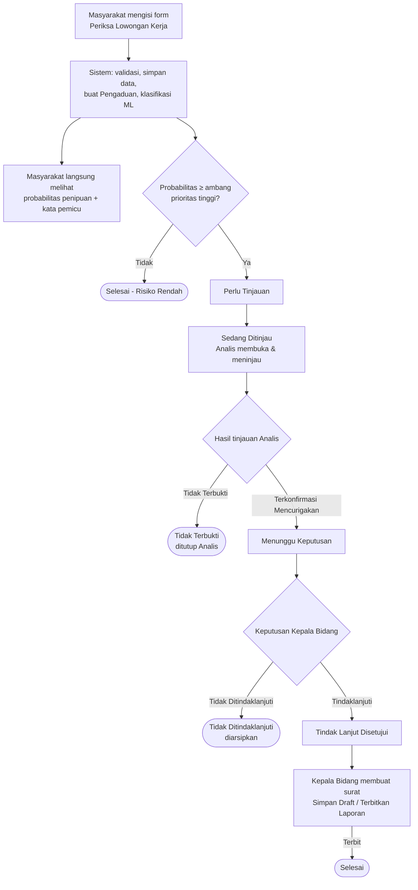

# PRD — LokerLens

**Product Requirements Document**
Sistem Deteksi Lowongan Kerja Mencurigakan sebagai Dukungan Pengawasan Informasi Ketenagakerjaan Digital

Sumber utama: SRS LokerLens v1.0 (8 Oktober 2026) dan Data Mockup LokerLens, ditambah keputusan tim per 20 Oktober 2026.
Dokumen terkait: [requirements.md](requirements.md) · [architecture.md](architecture.md) · [design.md](design.md)

---

## 1. Masalah

Lowongan kerja palsu mudah menyebar lewat media sosial dan platform digital. Karena sumbernya banyak, instansi pemerintah sulit memantaunya secara manual (SRS 1.2).

Kondisi saat ini (proses *As-Is*, SRS 2.1):
- Pengawasan bergantung pada laporan masyarakat yang diproses **satu per satu**.
- Front office menerima laporan, lalu Analis menginvestigasi **setiap** laporan secara manual.
- **Tidak ada penentuan prioritas**, sehingga beban Analis tinggi dan pemerintah sulit menentukan lowongan mana yang harus ditangani lebih dulu.
- Data lowongan kerja digital belum dimanfaatkan secara optimal.

## 2. Tujuan

LokerLens adalah **sistem pendukung pengawasan untuk instansi pemerintah** di bidang ketenagakerjaan. LokerLens bukan layanan publik. Masyarakat berperan sebagai sumber data.

Tujuannya (SRS 1.2):
1. **Deteksi dini.** Teks lowongan dianalisis dengan NLP dan *machine learning* untuk menghasilkan probabilitas penipuan dan kata pemicu.
2. **Penentuan prioritas.** Lowongan dengan probabilitas tinggi otomatis masuk antrean Analis, sehingga Analis cukup meninjau yang paling berisiko.
3. **Tindak lanjut yang cepat, sistematis, dan terdokumentasi.** Kepala Bidang memutuskan berdasarkan hasil sistem dan hasil tinjauan Analis. Setiap perubahan status kasus tercatat.

Prinsip penting: hasil klasifikasi hanya **rekomendasi**. Sistem tidak pernah menetapkan sendiri bahwa suatu lowongan adalah penipuan. Keputusan akhir ada pada Kepala Bidang (BR-04).

## 3. Aktor dan Perannya

| Aktor | Peran | Fitur utama |
|---|---|---|
| **Masyarakat** | Sumber data. Memeriksa lowongan yang dicurigai dan **langsung** melihat hasilnya. | Periksa Lowongan Kerja (F-01) |
| **Analis** | Meninjau lowongan berprioritas tinggi untuk memastikan apakah benar penipuan. Hasil tinjauan: **Terkonfirmasi Mencurigakan** (diteruskan ke Kepala Bidang) atau **Tidak Terbukti** (kasus ditutup oleh Analis). | Meninjau Lowongan Kerja dengan Prioritas Tinggi (F-02) |
| **Kepala Bidang** | Pemegang keputusan. Memilih **Tindaklanjuti** atau **Tidak Ditindaklanjuti**, lalu membuat dan menerbitkan Surat Teguran/Laporan Polisi. | Menindaklanjuti Laporan (F-03), Buat Surat Teguran/Laporan Polisi (F-04) |

Semua aktor wajib login. Akses dibatasi sesuai peran (NFR-SEC-01, NFR-SEC-02). Hanya Masyarakat yang bisa mendaftar sendiri. Akun Analis dan Kepala Bidang sudah disiapkan sebelumnya (SRS 2.6, asumsi 3).

> **Catatan perbedaan dengan SRS:** pada SRS, Analis hanya memberi catatan dan semua hasil tinjauan diteruskan ke Kepala Bidang (BR-06, BR-07). Keputusan tim mengubahnya: Analis boleh menutup kasus "Tidak Terbukti". Rincian dan usulan kalimat baru ada di [requirements.md §4](requirements.md#4-perbedaan-dengan-srs).

## 4. Fitur

### 4.1 Fitur utama (SRS Table 4.1)

| ID | Fitur | Aktor | Ringkasan |
|---|---|---|---|
| F-01 | Periksa Lowongan Kerja | Masyarakat | Mengisi nama perusahaan, posisi, dan deskripsi lowongan (minimal 50 karakter), lalu langsung melihat **probabilitas penipuan 0–100%** (makin tinggi makin tidak aman) dan **kata pemicu**. |
| F-02 | Meninjau Lowongan Kerja dengan Prioritas Tinggi | Analis | Melihat daftar prioritas tinggi, mencari/memfilter/mengurutkan, membuka detail, lalu mengisi catatan dan hasil tinjauan. |
| F-03 | Menindaklanjuti Laporan Lowongan Kerja yang Mencurigakan | Kepala Bidang | Meninjau detail laporan, memilih Tindaklanjuti atau Tidak Ditindaklanjuti melalui pop-up konfirmasi. |
| F-04 | Buat Surat Teguran/Laporan Polisi | Kepala Bidang | Melengkapi form yang data kasusnya terisi otomatis, lalu Simpan Draft atau Terbitkan Laporan. Surat hanya bisa terbit satu kali. |

### 4.2 Fitur pendukung

| Fitur | Aktor | Status di SRS |
|---|---|---|
| Registrasi, Login, Lupa Password | Semua | Pendukung (di luar Section 4) |
| Beranda | Masyarakat | Pendukung (SRS 3.1.3) |
| Status Pengaduan, Riwayat Pengaduan | Masyarakat | **[PERLU DISKUSI]** Masuk SRS atau tidak? (Appendix C no. 7) |
| Dashboard Analis, Dashboard Kepala Bidang, Arsip Kasus | Analis / Kepala Bidang | **[PERLU DISKUSI]** Sama seperti di atas (Appendix C no. 7) |

## 5. Alur Kasus: dari Pemeriksaan sampai Surat Terbit

Aturan alur status (keputusan tim):
1. Status hanya boleh **maju** sesuai urutan di atas. Status tidak boleh melompat atau mundur.
2. Ada **empat status akhir** yang tidak bisa diubah lagi: *Selesai - Risiko Rendah*, *Tidak Terbukti*, *Selesai*, dan *Tidak Ditindaklanjuti*.
3. Surat hanya bisa **terbit satu kali**.
4. **Setiap perubahan status** dicatat di Riwayat Kasus (BR-11, NFR-SAF-06).

Contoh kasus dari Data Mockup: lowongan *Staff Administrasi – PT Mandiri Sukses Global* (#LKR-8821) diperiksa Masyarakat dengan probabilitas 92%, masuk antrean Analis, diputuskan *Tindaklanjuti*, lalu diterbitkan Laporan Polisi `#LP-2026/POLRI/8821`.

## 6. Cakupan (SRS 1.2)

**Termasuk dalam versi 1.0:**
- Pemeriksaan lowongan kerja oleh Masyarakat sebagai sumber data.
- Klasifikasi lowongan beserta probabilitas penipuan (*confidence score*) dan kata pemicu.
- Penandaan lowongan berprioritas tinggi.
- Peninjauan lowongan berprioritas tinggi oleh Analis.
- Keputusan tindak lanjut oleh Kepala Bidang.
- Pembuatan dan penerbitan Surat Teguran/Laporan Polisi untuk kasus yang ditindaklanjuti.
- Registrasi dan login untuk membatasi akses sesuai peran.

**Di luar cakupan versi 1.0:**
- Menetapkan secara otomatis bahwa suatu lowongan adalah penipuan. Hasil klasifikasi hanya rekomendasi.
- Mengambil data lowongan secara otomatis dari media sosial atau situs lowongan. Data hanya masuk lewat pemeriksaan Masyarakat. *(Scraping hanya dipakai untuk menyiapkan data latih model, bukan fitur sistem.)*
- Mengirim laporan secara langsung ke sistem kepolisian.
- Verifikasi lapangan terhadap perusahaan pemberi lowongan.

## 7. Ukuran Keberhasilan

Diambil dari kebutuhan non-fungsional SRS. Angka yang masih TBD di SRS ditandai **[PERLU DISKUSI]**.

| Ukuran | Target | Sumber |
|---|---|---|
| Waktu tampil Daftar Lowongan Prioritas Tinggi | ≤ 3 detik untuk 100 data | NFR-PERF-01 |
| Waktu pemeriksaan lowongan (klik "Periksa Sekarang" sampai hasil tampil) | ≤ 5 detik pada minimal 95% dari 30 percobaan | NFR-PERF-02 |
| Pengguna bersamaan tanpa kegagalan | 20 pengguna | NFR-PERF-03 |
| Akses tanpa login / ke fitur peran lain | 100% ditolak | NFR-SEC-01, NFR-SEC-02 |
| Kinerja model (accuracy, precision, recall, F1) | **[PERLU DISKUSI]** Berapa nilai minimum tiap metrik? | NFR-QUA-04 |
| Kata pemicu per hasil | **[PERLU DISKUSI]** Minimal berapa kata? | NFR-QUA-06 |
| Masyarakat menyelesaikan pemeriksaan tanpa bantuan | **[PERLU DISKUSI]** Dalam berapa menit, oleh berapa % dari berapa responden? | NFR-QUA-02 |
| Ketersediaan sistem | **[PERLU DISKUSI]** Minimal berapa % waktu operasional? | NFR-QUA-03 |
| Jejak kasus | 100% perubahan status punya catatan Riwayat Kasus | NFR-SAF-06, BR-11 |

## 8. Hal yang Perlu Didiskusikan

Daftar lengkap ada di [requirements.md §6](requirements.md#6-daftar-perlu-diskusi). Yang paling berpengaruh ke produk:
- **[PERLU DISKUSI]** Ambang prioritas tinggi. Sementara memakai 70% (bisa diubah lewat config), tapi nilai final belum ditetapkan (SRS BR-05, Appendix C no. 18).
- **[PERLU DISKUSI]** Apakah Surat Teguran termasuk cakupan, atau hanya Laporan Polisi? (Appendix C no. 4)
- **[PERLU DISKUSI]** Fitur Dashboard, Status/Riwayat Pengaduan, dan Arsip Kasus: masuk cakupan atau tidak? (Appendix C no. 7)
