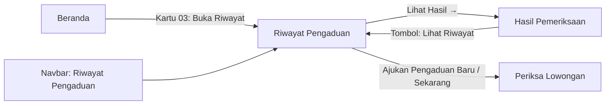

# UI/UX — Riwayat Pengaduan

**Fitur:** [Sprint 2] Riwayat Pengaduan (SRS 3.1.3, Appendix C no. 7)
**Aktor:** Masyarakat
**Route:** `GET /riwayat-pengaduan`
**Acuan desain:** [design.md](design.md) §3.2 (Beranda), §5 (Warna & Font)
**Mockup interaktif:** `docs/ui/riwayat-pengaduan-mockup.html` (buka di browser)

---

## 1. Wireframe Teks (Text Wireframe)

```
┌─────────────────────────────────────────────────────────────────────┐
│  NAVBAR  [LokerLens]  Beranda · Periksa Lowongan · Status ·        │
│                       ▉ Riwayat Pengaduan           Dinda Safitri ◉ │
└─────────────────────────────────────────────────────────────────────┘

┌─────────────────────────────────────────────────────────────────────┐
│  ┌─ BANNER (bg: navy-900) ─────────────────────────────────────┐   │
│  │  REKAM JEJAK PENGAWASAN          ┌─────┐ ┌─────┐ ┌─────┐   │   │
│  │  Riwayat /Pengaduan/             │  7  │ │  3  │ │  4  │   │   │
│  │  Daftar seluruh pengaduan ...    │Total│ │Brjln│ │Slsai│   │   │
│  │                                  └─────┘ └─────┘ └─────┘   │   │
│  └─────────────────────────────────────────────────────────────┘   │
│                                                                     │
│  ┌─ SEARCH BAR (bg: putih) ────────────────────────────────────┐   │
│  │  🔍 [Cari tiket, posisi, perusahaan] [▼ Semua Status]      │   │
│  │  [Cari] [Reset*]        |  [+ Ajukan Pengaduan Baru]       │   │
│  └─────────────────────────────────────────────────────────────┘   │
│  * Reset muncul hanya jika filter aktif                             │
│                                                                     │
│  Menampilkan semua pengaduan · 7 total laporan                      │
│                                                                     │
│  ┌─ KARTU 1 ───────────────────────────────────────────────────┐   │
│  │ LL-2026-0047    Staff Administrasi Online      KEYAKINAN    │   │
│  │ 08 Nov 2026     PT Sejahtera Digital • Jaksel   SISTEM      │   │
│  │ 14:32 WIB       [Perlu Tinjauan]              92%           │   │
│  │                                            Risiko Tinggi    │   │
│  │                                         [Lihat Hasil →]    │   │
│  └─────────────────────────────────────────────────────────────┘   │
│                                                                     │
│  ┌─ KARTU 2 ───────────────────────────────────────────────────┐   │
│  │ LL-2026-0041    Customer Service WFH — Gaji 8 Juta          │   │
│  │ 05 Nov 2026     CV Mitra Nusantara • Bandung    85%         │   │
│  │ 09:15 WIB       [Menunggu Keputusan]       Risiko Tinggi    │   │
│  │                                         [Lihat Hasil →]    │   │
│  └─────────────────────────────────────────────────────────────┘   │
│  ...                                                                │
│                                                                     │
│              ‹  [1]  2  ›                                           │
└─────────────────────────────────────────────────────────────────────┘
```

---

## 2. Spesifikasi Komponen

### 2.1 Header Banner

| Properti | Nilai |
|---|---|
| Background | `navy-900` (#0b1c2c) |
| Border | 1px `navy-800` |
| Border-radius | 16px (`rounded-2xl`) |
| Padding | 36px 40px |
| Label atas | "REKAM JEJAK PENGAWASAN" — `text-xs uppercase tracking-widest font-bold text-teal-400` |
| Judul | "Riwayat *Pengaduan*" — `text-3xl font-extrabold` + `font-serif italic text-teal-300` |
| Deskripsi | 13px, `text-gray-400`, max-width 420px |
| Dekorasi | Bulatan `teal-600/5` blur-3xl di sudut kanan atas |

**Kartu Statistik** (3 buah, grid horizontal):
| Metrik | Warna angka | Sumber data |
|---|---|---|
| Total Laporan | putih | `$pengaduan->total()` |
| Sedang Berjalan | `teal-300` | `$sedangBerjalan` |
| Selesai | `emerald-400` | `$selesai` |

### 2.2 Bilah Pencarian & Filter

| Elemen | Deskripsi |
|---|---|
| Input pencarian | Placeholder: "Cari nomor tiket, posisi, atau nama perusahaan..." — ikon 🔍 kiri |
| Dropdown status | Semua nilai dari `StatusKasus::cases()` |
| Tombol Cari | `btn-navy` |
| Tombol Reset | `btn-outline`, **muncul hanya jika** `request('cari')` atau `request('status')` |
| Divider | Garis vertikal 1px abu |
| Tombol Ajukan | `btn-teal` + ikon "+" |

### 2.3 Kartu Pengaduan

Layout horizontal 4 kolom:

| Kolom | Lebar | Konten |
|---|---|---|
| **Tiket & Tanggal** | 140px fixed | Badge nomor tiket (font-mono, `teal-50/teal-800`), tanggal + jam WIB |
| **Info Lowongan** | flex-1 | Posisi (bold), Perusahaan • Lokasi, Badge status |
| **Skor** | 100px fixed | Label "KEYAKINAN SISTEM", angka besar `XX%`, badge risiko |
| **Aksi** | shrink | Tombol "Lihat Hasil →" (outline, hover teal) |

**Warna badge status:**

| Status | Warna |
|---|---|
| Perlu Tinjauan / Sedang Ditinjau | teal (50/700/200) |
| Menunggu Keputusan | amber (50/700/200) |
| Tindak Lanjut Disetujui | blue (50/700/200) |
| Selesai | emerald (50/700/200) |
| Selesai - Risiko Rendah / Tidak Terbukti / Tidak Ditindaklanjuti | gray (100/600/200) |

**Warna badge risiko:**

| Skor | Label | Warna |
|---|---|---|
| ≥ 70% | Risiko Tinggi | merah (red-50/700/200) |
| 40–69% | Risiko Sedang | amber |
| < 40% | Risiko Rendah | emerald |
| null | "Belum diproses" | gray italic |

### 2.4 Paginasi

Laravel default Tailwind pagination (`$pengaduan->links()`).
Muncul hanya jika `$pengaduan->hasPages()`.

---

## 3. State Variasi

### State A: Ada Data (Default)
- Menampilkan kartu statistik terisi, daftar kartu pengaduan, pagination.

### State B: Data Kosong (Akun Baru)
- Statistik semua `0`.
- Teks wajib BDD: **"Belum ada pengaduan yang diajukan"** (`LokerLensCopy::BELUM_ADA_PENGADUAN`).
- Sub-teks: "Anda belum memiliki riwayat pengaduan lowongan kerja mencurigakan. Mulai laporan pertama Anda sekarang."
- Tombol: **"Ajukan Pengaduan Sekarang →"** → `periksa-lowongan.index`

### State C: Pencarian Tidak Cocok
- Teks: **"Data Lowongan Tidak Ditemukan"** (`LokerLensCopy::DATA_LOWONGAN_TIDAK_DITEMUKAN`)
- Sub-teks: "Tidak ada pengaduan yang sesuai dengan kata kunci atau filter yang dipilih."
- Tombol: **"← Lihat Semua Pengaduan"** → `riwayat-pengaduan.index` (tanpa filter)

---

## 4. Alur Navigasi



---

## 5. Kesesuaian dengan Design System

| Aspek | Acuan design.md | Implementasi |
|---|---|---|
| Font heading | Playfair Display serif italic | ✅ `font-serif italic` pada kata "Pengaduan" |
| Font body | Plus Jakarta Sans | ✅ `font-sans` |
| Warna primer | navy-900 `#0b1c2c` | ✅ Banner, navbar |
| Warna aksen | teal-600 `#1f8a7a` | ✅ Tombol, badge |
| Latar halaman | Gelap `bg-slate-900` | ✅ Sesuai `layouts/app.blade.php` |
| Border-radius kartu | 12px | ✅ `rounded-2xl` (16px, sedikit lebih besar tapi konsisten antar halaman) |
| Teks wajib BDD | `LokerLensCopy::BELUM_ADA_PENGADUAN` | ✅ Digunakan di empty state |
| Status dari enum | `StatusKasus::cases()` | ✅ Dropdown filter + badge |

---

## 6. Catatan

1. **Desain ini belum ada di Data Mockup asli** (design.md §1 baris 30). Desain dibuat mengikuti pola halaman Beranda (§3.2) dan Daftar Lowongan Prioritas Tinggi (§3.4).
2. Mockup interaktif HTML tersedia untuk preview visual — buka di browser untuk melihat ketiga state.
3. View Blade yang mengimplementasikan desain ini: `web/resources/views/riwayat-pengaduan/index.blade.php`.

